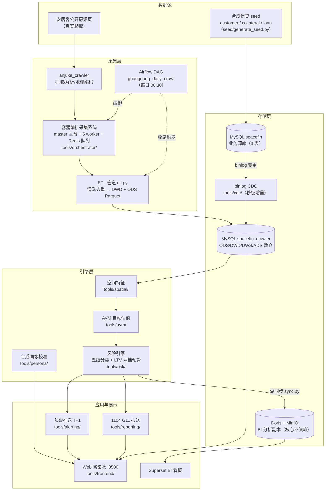

# 系统架构总览

> 目标：一张图 + 一条数据流，讲清整个系统怎么分层、数据从哪来到哪去。组件逐个细讲见 [components.md](components.md)。

## 分层结构

自上而下五层，数据自下而上流动：

| 层级       | 内容                                                                     | 代码位置                                   |
| ---------- | ------------------------------------------------------------------------ | ------------------------------------------ |
| L5 展示    | 零依赖 Web 驾驶舱（9 页、RBAC）、Superset BI（可选分析看板）            | `tools/frontend/`、`deploy/superset/`      |
| L4 应用接口 | LTV 预警推送（T+1）、1104 G11 报送、合规审计检索                         | `tools/alerting/`、`tools/reporting/`、`tools/compliance/` |
| L3 引擎    | AVM 自动估值、风险引擎（五级分类 / LTV）、合成画像校准（persona）        | `tools/avm/`、`tools/risk/`、`tools/persona/` |
| L2 空间    | 空间特征计算（高危区 / POI 密度 / 通勤近似，cKDTree 单机实现）           | `tools/spatial/`                           |
| L1 数仓    | MySQL `spacefin_crawler` 库 ODS/DWD/DWS/ADS 四层；Doris + MinIO 为 BI 副本 | `tools/lake/`、`sql/`                      |
| L0 数据源与采集 | MySQL `spacefin` 业务库（合成 seed）；安居客爬虫 + 容器编排采集系统 + binlog CDC | `seed/`、`tools/anjuke_crawler/`、`tools/orchestrator/`、`tools/cdc/` |

横切两层：**编排**（Airflow 每日 DAG 总控 + `tools/pipeline/` 统一数据链入口）与**运维**（`tools/ops/manage.sh` 三级资源策略、`deploy/systemd/` 服务托管、`.github/` CI）。

> **精简版说明**：原 L1 之上的 Kafka + Flink 实时流层（`tools/stream/`、`deploy/kafka-flink/`）已从本分支移除，预警改为 T+1 批处理推送。核心闭环不依赖实时层。

## 架构图

## 核心数据流（读这条就够）

1. **业务数据进库**：`seed/generate_seed.py` 确定性生成合成客户 / 抵押物 / 贷款，灌入 MySQL `spacefin` 库（`make up` 首次启动自动建表 + 导入 `sql/init/`）。
2. **行情数据采集**：Airflow 每日 DAG 拉起 `tools/orchestrator/` 采集栈（master 主备选举 + 泛化 worker + Redis 任务队列 + 代理池），爬取广东 21 城安居客挂牌房源；`etl.py` 清洗、按 `url_key` 跨日去重后写入 `spacefin_crawler` 库 DWD 表（`crawl_housing_sale` 等），同时落 ODS Parquet 数据湖。
3. **增量同步（CDC）**：业务库 `loan/collateral/customer` 的变更经 binlog 落入 ODS 变更日志表（`ods_cdc_log`），`tools/cdc/consumer.py` 增量重放到 DWS/ADS（批处理链路之外的第二条写入路径）。
4. **引擎计算**（T+1 批处理，顺序不可乱）：`tools/spatial/main.py` 产空间特征（`ads_spatial_zone` / `dws_spatial_feature`）→ `tools/avm/` 训练/推理估值 → `tools/risk/main.py` 重算五级分类与 LTV，写 `dws_risk_class` / `ads_ltv_alerts` / `ads_risk_class` → `tools/reporting/main.py` 生成 1104 G11 报送（三出口口径校验，不一致即阻断）→ `tools/alerting/main.py` 把当日 LTV 预警 T+1 推送贷后保全。这条链也可用 `tools/pipeline/run_pipeline.py` 一条命令按序跑完。
5. **展示**：前端驾驶舱（stdlib `http.server`，端口 8500）直读上述 MySQL 表渲染 9 个页面（P10 策略沙盒已并入 P6 策略推演中心）；Doris + MinIO 只是给 Superset 用的分析副本，坏了核心照跑。

## 双库设计（易混点）

| 库                | 内容                                             | 写入方                       |
| ----------------- | ------------------------------------------------ | ---------------------------- |
| `spacefin`        | 业务源库：`customer` / `collateral` / `loan` 三表 | 合成 seed / 演示回填         |
| `spacefin_crawler` | 爬虫原始表 + 全部数仓分层（ODS/DWD/DWS/ADS）     | ETL、CDC、各引擎             |

核心闭环读写**同一个 MySQL 实例**的这两个库。注意两处都叫「ODS」但不是一回事：采集侧 ODS 是 Parquet 数据湖，CDC 侧 ODS 是 binlog 变更日志表（默认空是预期，见根 README 的说明）。

## 关键端口

| 服务              | 端口 | 说明                         |
| ----------------- | ---- | ---------------------------- |
| MySQL             | 3306 | 仅监听 127.0.0.1             |
| Redis 任务队列    | 6379 | 采集派单 / 代理池 / 主备锁   |
| 前端驾驶舱        | 8500 | `tools/frontend/app.py`      |
| 采集 master（Docker） | 5100 | HTTP API（任务/代理/状态） |
| 采集 master（dev 热重载） | 5102 | 避开 Docker 栈，Redis db=1 隔离 |
| 宿主渲染服务      | 8899 | `/render`、`/health`         |
| Doris FE          | 9030 | MySQL 协议兼容（BI 副本查询） |
| Superset          | 8088 | 可选，需独立部署             |

## 延伸阅读

- 组件级技术说明（19 篇）：[../tech/components/](../tech/components/)
- 风险引擎 / AVM / 前端三篇最贴近核心闭环：[risk-engine.md](../tech/components/risk-engine.md) · [avm.md](../tech/components/avm.md) · [frontend.md](../tech/components/frontend.md)
- VPS 部署实录（含精简版说明）：[../../deploy/vps/DEPLOYMENT.md](../../deploy/vps/DEPLOYMENT.md)
